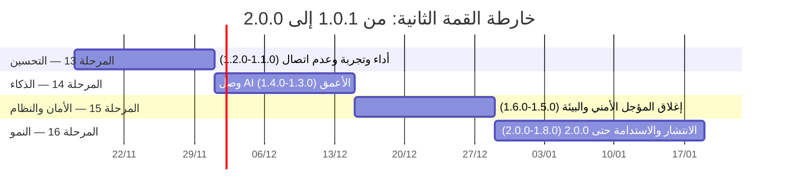

# خارطة القمة الثانية — من 1.0.1 إلى 2.0.0 (المراحل 13–16): التطوير والإكمال والتحسين الشامل

آخر تحديث: 2026-11-18 · نقطة الانطلاق: **1.0.1+62** · **المنجز حتى 1.9.0+71 (المرحلة 16 — بوابة الاختبار الميداني والمحركات النقية ودليل الاستضافة)** · الهدف: **2.0.0+72** — تعديل موثق: المرحلة 15 امتدت لإصدار ثالث (15 ج) فانتقلت المرحلة 16 إصداراً واحداً (1.8.0+70 → 2.0.0+72)

## المنهج والغرض

اكتملت خارطة القمة الأولى (`docs/GRAND_PLAN.md`، المراحل 8–12) بإصدار الاستقرار 1.0.0 وترقعة 1.0.1 — وبذلك أُغلق كل بند برمجي فيها. هذه الوثيقة تفتح **القمة الثانية**: ما بعد الاستقرار، بثلاثة مسارات واضحة في كل مرحلة:

- **تطوير**: ميزات جديدة ترفع السقف أمام الأقوى عالمياً.
- **إكمال**: بنود مؤجلة بوعي منذ إصدارات سابقة (موثقة في E2EE_PLAN §9 وMLS_DESIGN وON_DEVICE_LLM) تُغلق في موعدها.
- **تحسين**: كل ما هو قائم يصير أسرع وأخف وأسهل — بأرقام مقاسة تُعرض في الشفافية لا بأدعاء.

القواعد الثابتة وراثةً من القمة الأولى: الصدق قبل الميزة، الخصوصية قبل كل شيء، ميزانية صفر حتى قرار المالك، وكل إصدار تحليل نظيف واختبارات ناجحة وحزمة موقعة من القناة العامة نفسها.

## أين نقف الآن — جرد 1.0.1+62 وفجوات ما بعد الاستقرار

| المجال | الواقع المثبت في الشجرة | الفجوة المتبقية | مكان الإغلاق |
|---|---|---|---|
| التشفير | X3DH ثلاثي + Double Ratchet + هجين ML-KEM-768 (033) + وسائط على الجلسة المتدرجة + إزالة جهاز كاملة + شفافية مفاتيح بسلسلة متحققة محلياً (034) | توقيع المفاتيح الأولية Ed25519 (§9 مؤجل)، الشهود الخارجيون لشفافية المفاتيح (حد F7)، MLS للجمعات الضخمة (تصميم جاهز بلا تنفيذ) | المرحلة 15 |
| الرسائل والوسائط | ألبومات وتحرير صور وإجراءات إشعار وتصدير ومسح (031) ومعاينة روابط وبحث موحد ومعرض وTTS وويدجت وجرس قنوات (032) | **لا طابور إرسال بلا شبكة** — رسالة تُرسل وفشلت الشبكة تعتمد على سلوك الخصائص القائم، وحد الملفات 24 م.ب بند مالك (كود MediaLimits جاهز) | المرحلتان 13 و16 |
| الصوت والمكالمات | فردية صوت ومرئي P2P مشفرة (028) + رن فوق القفل + شارة جودة متكيفة + موجات «يتحدث» + مشاركة شاشة + جماعية حتى 8 على المحرك نفسه + فيديو حالات (035) | TURN خلف NAT المتماثل (بند مالك — تعليمات §8 جاهزة)، وفوق 8 يحتاج SFU/LiveKit بقرار مالك | المرحلة 15 |
| الذكاء (وصل AI) | محركات على الجهاز حصراً: نوايا وملخص وبحث ذكي ودلالي متجهي وترتيب ذكي وصياغة بأسلوبك وكشف وعود وتذكير محلي وتقويم هجري مجتمعي وترجمة قاموسية + سحابية بموافقة | النموذج اللغوي على الجهاز: تقييم بحثي منجز (0.23.0) والربط الفعلي مؤجل بوعي حتى قياس ميداني — موثق في `ON_DEVICE_LLM.md` | المرحلة 14 |
| المنصات | أندرويد كامل بAPK موقّع آلي + ويندوز/لينكس/ماك بحزم منشورة (0.28.0) + iOS بناء أرشيف جاهز (0.29.0) + ويب PWA وإشعارات متصفح Web Push متحققة بدوري (036) | Google Play غير مفتوح (بند مالك 25$ — الحزمة والمواد جاهزة في `PLAY_SUBMISSION.md`)، iOS غير منشور (بند مالك 99$ — إجراءات §9 جاهزة) | المرحلة 16 |
| الجودة | 640/640 اختباراً نقياً في 54 ملفاً وتحليل نظيف 100% ومراجعتان أمنيتان مفتوحتان بعلامات F1–F18 وقائمة اختبار ميداني مرقمة ومركز Realtime واحد بتقليم متسربين وتدقيق تباين دائم | القياس الاستهلاكي الميداني قبل/بعد، وبعض الشاشات الأقدم بلا تسميات وصول كاملة | استمرار عبر المراحل 14–16 |

---

## المرحلة 13 — التحسين الشامل: أداء وتجربة وعدم اتصال (1.1.0+63 → 1.2.0+64)

**الهدف: أن يصير وصل أسرع وأخف وأسهل تطبيق عربي — بأرقام قبل/بعد تُعرض في تقرير الشفافية لا بادعاءات.**

- [x] **طابور إرسال بلا شبكة (offline-first للرسائل)** — **منجز 1.1.0**: `offline_queue_service.dart` نقٍّ مُختبَر: الفشل لغير الحظر/الكتم/السياسة يحفظ الرسالة محلياً (نص مشفر كما يراه الخادم، ووسائط بايتاتها المشفرة ملفاً مؤقتاً) بشريط صادق بعدّ المحفوظات، وتُعاد المحاولة تلقائياً بالترتيب نفسه عند فتح قناة Realtime وبداية التطبيق ونبضة كل 30 ثانية — الحذف بعد تأكيد الخادم حصراً فلا تكرار، والفشل يوقف عند أول عنصر ويعاود محاولته في موضع لا نهاية، وسقوف معلنة 50 محفوظة و8 محاولات — بلا ترحيل خادمي إطلاقاً — *(1.1.0)*
- [x] **قائمة الرسائل الافتراضية الكاملة** — **منجز 1.1.0**: القائمة الافتراضية القائمة (ScrollablePositionedList تبني المرئي حصراً منذ 0.21.0) صارت مقيسة لا مدعاة: `jank_service.dart` نقٍّ مُختبَر يلتقط كل إطار (بناء + رستر) في نافذة متدحرجة 600 بعتبة صادقة معلنة 32ms، وكتابة منقحرة كل 50 إطاراً، وأربعة أرقام حية في ورقة المؤشرات (نسبة التعثر والمتوسط وأعلى 95% وأثقل إطار) بمنهجية معلنة — *(1.1.0)*
- [x] **ذاكرة وسائط ذكية بسقف معلن** — **منجز 1.1.0**: `lru_cache.dart` بنية نقية مُختبَرة تُطبّق على ذاكرة روابط الوسائط المؤقتة (كانت خريطة بلا سقف تنمو مع طول الجلسة) — السقف يعرضه صاحبه ويعدّله من ورقة المؤشرات (100/300/1000 والافتراضي 300 موثق) ويُحفظ، والأحدث استعمالاً يبقى والأقدم يُخلى ذاتياً بعدّ إصابات وإخلاءات حي، والمسح يمس الروابط المؤقتة حصراً — **الأصل على الخادم لا يمسه أبداً** (ما نخزنه روابط موقعة لا بايتات) — *(1.1.0)*
- [x] **تقليل البطارية والشبكة** — **منجز 1.2.0**: مركز Realtime الواحد `realtime_hub_service.dart`: قناة postgres واحدة `wasl-hub` تحمل المشاهدين طويلة العمر الأربعة — تُنشأ مرة عند الدخول وتُفك مرة عند الخروج **وزيارة الشاشة لا تنضم للخادم إطلاقاً** (كانت قائمة المحادثات وسجل المكالمات يفتحان قناة كل زيارة ويركانها)، وجريانات بثّية بلا تخزين، و`HubRegistry` نقي مُختبر يرفض التسجيل المكرر لمالك حاضر ويحصّله فالتسريب يُكشف بالعدّ لا يُدّعى (أرقام حية في ورقة المؤشرات)، والقنوات اللحظية العابرة تبقى مستقلة وأحداث postgres كما كانت تماماً (RLS لحظة الحدث) — والقياس الاستهلاكي قبل/بعد على جهاز متوسط يبقى بنداً ميدانياً موثقاً (معلناً في الشفافية لا مخفياً)
- [x] **RTL وإمكانية الوصول النهائية** — **منجز 1.2.0**: تباين WCAG 2.x تدقيق دائم — `contrast_service.dart` نقي مُختبر بجداءات مرجعية يفحص `contrast_audit_test` كل طبقات نص وصل على خلفياتها الفعلية في الوضعين مع كل بناء (≥4.5 للأساسي والثانوي و≥3.0 للخافت بألفا مدموجة)، ولونان فاتحان صُدّلا (ink3→#6B7590 كان 3.79 وink4→#7D87A0 كان 2.54)، وتسميات وصول عربية لأزرار الأيقونات عالية المرور، والحدود المعلنة في مركز المساعدة: المراجعة الميدانية على أجهزة حقيقية تبقى بنداً موثقاً والتركواز على الفاتح زخرفي حصراً
- [x] **نضج الاختبارات وحجم الحزمة** — **منجز 1.2.0**: +71 اختباراً نقياً في 5 ملفات جديدة تغطي خدمات بلا ملف إختبار — المجموع **640/640** فوق هدف 600+، وتدقيق اعتماديات ببرهان الاستعمال: **صفر اعتماديات ميتة** من الـ26 (كل حزمة لها ملف استعمال مثبت فلا حذف متهور)، وهدف حجم موثق: **≤75 م.ب عبر القمة الثانية كلها** مع القياس المنشور كل إصدار (القائم 73.0 م.ب في 1.1.0)
- معايير قبول المرحلة: أرقام قبل/بعد لكل بند تُكتب في `TRANSPARENCY.md` وملاحظات الإصدار؛ لا ترحيل خادمي إلا إن اقتضاه بند فعلاً؛ تحليل نظيف واختبارات ناجحة والحزمة موقعة من القناة العامة.

## المرحلة 14 — وصل AI الأعمق: من المحركات إلى النموذج (1.3.0+65 → 1.4.0+66)

**الهدف: أن يفهم وصل معنى رسائلك وأرشيفك على جهازك حصراً — والنموذج اللغوي خيار بتنزيل صريح لا فرض ولا ادعاء.**

- [x] **اسأل وصل: أرشيفك يجيبك محلياً (RAG فوق الدلالة القائمة)** — **منجز 1.3.0** — *(1.3.0)*: واجهة «اسأل وصل» تجيب سؤالك من رسائلك المفكوكة على جهازك فقط: البحث الدلالي المتجهي القائم (0.22.0) يجيب المقاطع ذات الصلة ومحرك الاستخلاص يبني الإجابة منها، وكل إجابة تعلن مصدرها (المحادثة والتاريخ) — **صفر حرف يغادر الجهاز**، والسحابي الأعمق يبقى بديلاً اختيارياً بموافقة صريحة لكل استخدام.
- [x] **الملخص الأسبوعي للمحادثات والمجتمع** — **منجز 1.3.0** (لكل محادثة تُفتح من قائمة وصل AI: خاصة ومجموعة وقناة وغرف المجتمعات) — *(1.3.0)*: بنمط الملخص اليومي المُختبَر نفسه بنافذة أسبوع متدحرجة — لكل محادثة ولوحة مجتمع، تخزين محلي آمن وبلا شبكة.
- [x] **ترجمة محلية موسعة وكشف لغة** — **منجز 1.3.0** (كتالوج موسع +كشف كتابة تلقائي +سحابية فرنسي/تركي/أوردو بحارس نتيجة صادق — النشر الفعلي للغات الثلاث بند مالك: `npx supabase functions deploy ai`) — *(1.3.0)*: كتالوج العبارات القاموسي يتوسع (التحيات والمواعيد والأرقام والتعبيرات المتكررة في المراسلة العربية) وكشف اللغة التلقائي للنص المعروض، والسحابية تتوسع لغات أكثر (فرنسي/تركي/أوردو حسب طلب المستخدمين العربي) بموافقته القائمة.
- [x] **بحث وسائط صادق** — **منجز 1.4.0**: `MediaSearchService` نقي مُختبَر: الاسم والتعليق والنوع والحجم والتاريخ والمحادثة المصدر فوق معرض 0.21.0 — ميتاداتا محلية حصراً بإفصاح حرفي معروض، والحجم للملفات/الفيديو حصراً والباقي يُستبعد بصدق، وعدم اختراع نتائج لكلمات داخل محتوى الصور مُختبَر.
- [x] **تذكيرات المناسبات الهجرية العربية** — **منجز 1.4.0**: `HijriOccasionsService` نقي مُختبَر فوق HijriService المتحققة: خمس مناسبات (الرأس ورمضان والعيدان وعرفة) بأقرب حدوث ووصف قرب عربي، وشاشة بالإعدادات ومفتاح تذكير يجدول **إشعارات محلية حصراً** بتعليمات تمنع التكرار وإلغاء بمعرّف حتمي — والحساب حسابي والرؤية قد تزيح يوماً معروض في الشاشة.
- [ ] **النموذج اللغوي على الجهاز: تنفيذ المسار البحثي الموثق** — *(1.4.0 → مؤجل موثق)*: **جهاز القياس المتوسط لم يتوفر في 1.4.0 أيضاً — المسار يبقى مؤجلاً موثقاً ولا ادعاء** (محدث في ON_DEVICE_LLM.md بتاريخ الجلسة): عند توفره يُنفذ سيناريو `ON_DEVICE_LLM.md` القائم: تنزيل صريح بالحجم قبل أي تشغيل، وحكم الجهاز معلن بمعاييره المكتوبة، ومفتاح تعطيل فوري، والفشل يهبط للمحركات القواعدية بصدق — وتكلفة التأجيل صفر لأن المرحلة 14 اكتملت ببنودها الأخرى كاملة بلا نموذج.
- معايير قبول المرحلة: كل محرك جديد يُوثق ب§8 في `E2EE_PLAN.md` (لا تدفق جديد على السلك إلا بحدود صريحة)؛ اختبارات نقية لكل محرك؛ إفصاح TRANSPARENCY لكل بند قبل الإصدار.

## المرحلة 15 — الأمان والنظام البيئي (1.5.0+67 → 1.6.0+68)

**الهدف: إغلاق كل بند أمني مؤجل بوعي، وتوسيع النظام البيئي للمطورين والمجتمعات الكبيرة — والمراجعة الأمنية الرابعة تحرس كل خطوة.**

- [x] **Ed25519 لتوقيع المفاتيح الأولية** — **منجز 1.5.0** — *(1.5.0)*: تنفيذ §9 المؤجل في `E2EE_PLAN.md` كاملاً (§8-ص، ترحيل 037): مفتاح توقيع Ed25519 لكل جهاز يوقّع كل مفتاح أولي يُنشر بدالة إلحاح مطورة بالنوع الخامس signing_publish، والتحقق **تلقائي عند بدء كل جلسة قبل قبول المفتاح المسحوب** (أعمق من المخطط الذي اكتفى بالتحقق عند التوثيق اليدوي) — فشل التحقق يُهمل الجهاز بلا هبوط كلاسيكي، والطرف القديم بلا توقيع يبقى يعمل حرفياً — توافق رجعي كامل بنمط ترحيل 033.
- [x] **النسخة الاحتياطية الكاملة المشفرة (بند مضاف بهذا الإصدار)** — **منجز 1.5.0** — *(1.5.0)*: فتح القرار المؤجل من جرد القمة الأولى (§1: «لا تصدير محادثات مشفرة كامل — قرار لا يُفتح قبل 1.0») بالشكل الصادق الوحيد — §8-ص في `E2EE_PLAN.md`: جلب آخر 500 رسالة لكل محادثة وفك محلي وتشفير بكلمة سر المستخدم (PBKDF2 310000 + AES-256-GCM بترويسة WASLBK1 بنمط نسخة المفاتيح) في ملف `.waslbackup` على جهازه حصراً — الخادم لا يرى كلمة السر ولا الملف ولا أي حرف — والفتح لاحقاً قراءة فقط بلا أي إعادة رفع، والوسائط سطر تسمية والعرض-مرة-واحدة والمحذوفة لا تدخلان وكلمة السر لا تُستعاد لأحد (معروض في الشاشة نفسها).
- [x] **شهود خارجيون لشفافية المفاتيح (إغلاق حد F7)** — **منجز 1.6.0** — *(1.6.0)*: ترحيل 038 بدالتين خادمتين عموميتين قراءة-حصراً (بصمة عمياء لرأس كل سلسلة `sha256('wt1|'+uid+head)` وبصمة لقطة كلية مرتبة — لا معرّفات ولا مفاتيح ولا هويات، وصاحب الحساب وحده يربط بصمته بنفسه)، وأداة مراقبة مفتوحة المصدر بلا اعتماديات `tools/key_transparency_witness.py` ترفض الإلحاح بلا تحقق اتساق اللقطة وسجلها رتيب الزمن، وشاهد آلي بسير `key-witness.yml` يلحق لقطة كل ساعة بفرع `witness-log` العام بلا أي سر، و`KeyWitnessService` نقية بمتجهات ثابتة محسوبة خارجياً وبطاقة «بصمتك عند الشهود» في سجل مفاتيحي، ووثيقة `docs/WITNESS.md` تشرح لأي طرف التحقق خطوة خطوة — **الحد البنيوي المعلن منذ 0.25.0 أُغلق بأداة عامة لا بوعد** والحد المتبقي (خادم يظهر وجهين لشاهدٍ وصاحب سلسلة) موثق صادقاً في WITNESS §6.
- [ ] **MLS للجمعات الضخمة عند تجاوز السعة فعلياً** — *(1.6.0)*: تنفيذ خطة `MLS_DESIGN.md` وثيقةً بثوثقةً كاملة: اختيار المكتبة بمعاييرها الأربعة المكتوبة (نقية/صفر اعتماديات/متجهات interop/نضج) أو بناء النواة داخلياً، وepochs وCommit عبر البنية القائمة بلا خادم جديد، وانتقال بتوافق كامل — **لا يبدأ قبل ظهور مجموعات حقيقية فوق حدود النمط المغلف المعلنة** (التسليم المغلف موثق بحدوده) فلا تعقيد بلا حاجة مثبتة.
- [x] **واجهة مطوّرين موسعة** — **منجز 1.7.0** — *(1.7.0)*: أحداث webhooks جديدة بتوقيع HMAC نفسه (ترحيل 039): انضمام عضو ومغادرته تصل البوتات النشطة ذات الويب هوك في المحادثة لحظياً — بيانات عضوية كانت غائبة كلياً وهي كل ما أُضاف لما يخرج من الخادم (member_id وchat_id ونوع الحدث — موثق TRANSPARENCY)، وحقل `proposal` اختياري في sendMessage يخزَّن بعد تحقق صارم (غرف المجتمعات العامة حصراً وهدف عضو فعلي فيها وشكل مغلق mute/kick ومدة 1–43200 وسبب ≤200)، ووثيقة الدليل الشامل `docs/BOT_GUIDE.md` خطوة بخطوة — **بلا صلاحية جديدة تتجاوز نموذج البوت القائم**: البوت يقرأ ويكتب رسائله ويقترح، ولا ينفذ شيئاً على أحد
- [x] **الإشراف الآلي الفاعل وسوق بوتات مبسط** — **منجز 1.7.0** — *(1.7.0)*: أنماط `BOT_MODERATION_PATTERNS.md` انتقلت من «ينبه» إلى «ينفذ بعد موافقة المشرف لحظة بلحظة»: المقترح يخزن معلقاً وشاشة الإشراف تبويبها الجديد «مقترحات البوتات» يعرض كل مقترح ببطاقة بأزرار «موافقة وتنفيذ» و«رفض» — والتنفيذ **بصلاحية المشرف نفسه** عبر دوال 023 (auth.uid() هو الفاعل) وأي إخفاق إشرافي حقيقي (هدف مشرف) يعلن بصدق ويبقي المقترح معلقاً، والتنفيذ التلقائي مرفوض تصميمياً؛ ودليل النشر `BOT_GUIDE.md` كامل؛ ولوحة إحصاءات البوت توسعت بما يمكن قراءته فعلاً من ترحيل 039 (الرسائل المرسلة ونشاط 24 ساعة وآخر نشاط والوصول المقاس المعلن كتقدير وحالة المقترحات) بلا تخزين جديد — «سوق البوتات» المبسط مؤجل موثق حتى إطلاق Play (بند انتشار لا بند كود)
- [ ] **TURN ذاتي الاستضافة عند قرار المالك** — *(بند مالك — الكود جاهز)*: تعليمات RUNBOOK §8 المحدثة تنشر coturn ويُضاف للإعدادات، فيرتفع نجاح الاتصال خلف NAT المتماثل — والكود يستقبله من الإعدادات دون ترحيل.
- معايير قبول المرحلة: **المراجعة الأمنية المفتوحة الرابعة** بنتائج مرقمة جديدة في `SECURITY.md` تغطي التوقيع والشهود وأي تنفيذ MLS؛ لا ترحيل بلا تحقق pglast وفحص RLS صلاحيةً صلاحية؛ توافق المسارات السلكية الأربعة يُختبر بعد كل بند.

## المرحلة 16 — النمو والاستدامة حتى 2.0.0 (1.8.0+70 → 2.0.0+72) — منزاحة إصداراً موثقاً لاكتمال المرحلة 15 بإصدار ثالث

**الهدف: من الاستقرار إلى الانتشار الحقيقي — مستخدمون فعليون، ونموذج استدامة صادق بلا إعلانات ولا بيع بيانات.**

- [ ] **إطلاق Google Play الرسمي** — *(1.7.0 — بند مالك 25$)*: الحزمة المرشحة والمواد الكاملة جاهزة في `PLAY_SUBMISSION.md` منذ 0.19.0، وما بعد القبول: شاشة «تحديث متوفر» توجّه للمتجر وتحفظ القناة العامة كخيار مباشر بجواره.
- [ ] **نشر iOS بعد التوقيع** — *(1.7.0 — بند مالك 99$)*: أرشيف Runner.app الذي يبنيه CI منذ 0.29.0 يوقّع ويرفع وفق RUNBOOK §9 خطوة بخطوة.
- [x] **اختبار ميداني واسع (beta داخل التطبيق)** — **منجز 1.8.0** — *(1.8.0)*: شاشة «برنامج الاختبار الميداني» من الإعدادات قناة انضمام بعائِل صادق حرفي — ما يُختبر بثمانية بنود فعلية من خارطة الفعل (المتدرج والوسائط وما بعد الكم وشفافية المفاتيح والمكالمات والغرف والمجتمعات والبوتات ووصل AI وتعدد الأجهزة) وما لا يزال ناقصاً بأربع بنود كما في TRANSPARENCY حرفياً (Play وiOS بقرارا المالك وTURN والترحيلات غير المشغلة)، وانضمام محلي حصراً في المخزن الآمن بخمسة مجالات (الرسائل والتشفير / المكالمات والغرف / المجتمعات والبوتات / وصل AI / كل شيء) — **بلا أي صف خادم ولا قائمة ولا إشعار ولا تغيير إعداد**، بإفصاح حرفي معروض قبل الضغط وبعده وقناة رسمية تقول «إن وُجدت» لا ادعاء بوجودها، وتقرير اختبار يبني على نظام الملاحظات القائم (029) بقالب معبأ مسبقاً: بصمة المجال والإصدار والمنصة وحقول فراغ يملؤها العائِل وتذكير خصوصية — ضمن حد الخادم 1500 وبفحص التحقق قبل الإرسال، والمغادرة تمسح الأثر المحلي كله، و16 اختباراً نقياً تثبت العائِل والقالب والحالة — بوابة 2.0.0 وإصلاح ما يصل من تقاريرها بأولوية.
- [x] **فتح المحركات النقية مفتوح المصدر** — **منجز 1.9.0** — *(1.9.0)*: ست حزم Dart نقية في `engines/` جاهزة الدفع كمستودعات مستقلة (`wasl_ratchet` — النواة التشفيرية كاملة بX3DH والمتدرج وEd25519 وML-KEM الهجين؛ `wasl_semantic` — البحث الدلالي المتجهي بمحركه المرجعي؛ `wasl_hijri` — التقويم الهجري الحسابي؛ `wasl_translate` — الترجمة القاموسية المحلية بمحركها؛ `wasl_model_gate` — بوابة تقييم النموذج على الجهاز؛ `wasl_voice_waves` — مستوى الصوت من إحصاءات WebRTC وكاشف «يتحدث» بهسترة عتبتين) — **المصدر منسوخ حرفياً من كود التطبيق بلا تعديل** والاختبارات مكيَّفة الاستيراد فقط وتجتازها كل حزمة منفردة ب`dart test` (69 اختباراً عبر الست)، ورخصة MIT موحدة، وفحص أسرار آلي `scripts/scrub_engines.py` بنتيجة صفر على 40 ملفاً — والدفع كمستودعات عامة مستقلة بيد المالك (بند RUNBOOK) لأنه يخلق مستودعات جديدة على حسابه.
- [x] **دليل استضافة ذاتية كامل** — **منجز 1.9.0** — *(1.9.0)*: `docs/SELF_HOSTING.md` وثيقة عشر فصول: ما تحتاج فعلاً بجدوله، Supabase ذاتي الاستضافة دوكر، الترحيلات 001→039 بالترتيب الكامل، توجيه التطبيق وconfig.dart، الدوال السبع بأسرارها موثقة من ترويسات الكود نفسها، coturn TURN بأمر التشغيل والمنافذ، الإشعارات بصدقها (FCM يحتاج حسابك وVAPID مفاتيحك — بلا حساب تعمل كل الميزات عدا الإشعارات)، النسخ الاحتياطي pg_dump بما يشمل الوسائط المشفرة، والصيانة الدورية — وحدّا صادقان معلنان: الحزمة العامة موجهة للخادم الرسمي (التوجيه وقت البناء)، والأرقام عن بنيتك الخاصة تقيسها أنت.
- [ ] **2.0.0+72: إصدار النضج** — *(2.0.0)*: المراجعة الأمنية الخامسة، تقرير شفافية 2.0 بجرد كامل، اختبار ميداني على ثلاثة أجهزة حقيقية، ووسم رسمي يبني المنصات الأربع دفعة واحدة — إعلان التطبيق العربي الذي لا يخون، بعدوى قابلة للتحقق.
- معايير قبول المرحلة: كل منصة جديدة من القناة الآلية نفسها؛ لا إصدار قبل تحليل نظيف واختبارات ناجحة؛ تقرير الشفافية يتحدث مع كل خطوة ويبقى بلا استثناء جديد.

## مسار التحسين المستعرض (في كل إصدار من 13 إلى 16)

- كل خدمة جديدة تولد مع اختبارها النقي وإفصاح `TRANSPARENCY.md` وربط §8 إن لمست السلك.
- لا ترحيل SQL بلا تحقق المحلل الرسمي pglast وفحص RLS صلاحيةً صلاحية.
- حجم الحزمة وزمن البناء يُقاسان ويوثقان في ملاحظات كل إصدار.
- الوثائق الثلاث (README وRUNBOOK وTRANSPARENCY) تتحدث مع كل إصدار قبل الدفع.
- قاعدة الرسائل النظيفة للمرآة: إصدارات القناة العامة بلا «[skip ci]» أبداً، والالتزامات التوثيقية تحملها عمداً.
- الأسرار في `secrets/` بالمستودع الخاص حصراً، وشجرة كل وسم تتحقق برمجياً قبل الدفع (قاعدة F17).

## المخطط الزمني المرئي

## ما لن نفعله أبداً (وراثة من القمة الأولى وتوسيعها)

1. تسجيل المكالمات — مرفوض بلا نقاش.
2. رفع أي محتوى مشفر لطرف ثالث أو لواجهة ذكاء بلا موافقة صريحة لكل استخدام.
3. إعلانات داخل المحادثات، أو بيع/مشاركة بيانات — الاستدامة تُبنى بقرار مالك شفاف لا ببيع المستخدم.
4. ميزة «شبه مشفرة»: أي مسار صريح يُكتب صراحة في الواجهة والشفافية، لا يُلبس برسالة تشفير.
5. **(جديد)** نموذج لغة يُنزَّل ضمنياً: أي نموذج على الجهاز يصلك بتنزيل صريح بالحجم ومفتاح تعطيل — لا تضمين في الحزمة ولا تنزيل خفي.
6. **(جديد)** مستودع مفتوح يحتمل سراً واحداً: المراجعة قبل النشر بند معياري لا خطوة شكلية.

## بنود المالك المجمعة في القمة الثانية (قرارات لا تنفذها الأدوات)

| البند | التكلفة | يفتح ماذا | موعده |
|---|---|---|---|
| فتح Google Play Console | 25$ مرة واحدة | الإطلاق الرسمي أندرويد (المرحلة 16) — المواد جاهزة | 1.7.0 |
| Apple Developer | 99$/سنة | نشر iOS (المرحلة 16) — الإجراءات جاهزة §9 | 1.7.0 |
| Supabase Pro | 25$/شهر عند النمو | رفع حد الملفات فوق 24 م.ب (كود MediaLimits جاهز من 0.28.0) | عند النمو |
| TURN ذاتي الاستضافة | خادم بسيط | نجاح مكالمات خلف NAT المتماثل (المرحلة 15 — تعليمات §8 جاهزة) | 1.6.0 |
| جهاز قياس متوسط للنموذج | جهاز قائم | تفعيل مسار النموذج على الجهاز (المرحلة 14 — السيناريو جاهز) | 1.4.0 |
| تجديد دقائق Actions الخاصة | مجاني عند التجديد | عودة CI الخاص (القناة العامة تؤدي الدور كاملاً اليوم) | متى شاء |

## مؤشرات النجاح للقمة الثانية

- فتح بارد أقل من 1.5 ثانية على جهاز متوسط — مقاساً بMetricsStore ومنشوراً في الشفافية.
- تمرير قائمة بعشرة آلاف رسالة بلا سقط إطارات مقاس — رقم معلن.
- رسالة بلا شبكة تصل تلقائياً عند العودة — مختبرة نقياً وميدانياً.
- 600+ اختبار نقية وتحليل نظيف في كل إصدار من القمة الثانية.
- صفر ترحيل بلا تحقق pglast، وصفر سر خارج `secrets/`، وصفر بند شفافية بلا كود يثبته.
- تقييم 4.6+ في Play بعد الإطلاق، وتقرير شفافية بلا استثناء جديد عند 2.0.0.

## مراجع

- `docs/ROADMAP.md`: خارطة الطريق الكاملة — المراحل المنجزة 0–12 والقمة الثانية.
- `docs/GRAND_PLAN.md`: خارطة القمة الأولى (8–12) — مكتملة بإصدار الاستقرار 1.0.0 وترقعة 1.0.1.
- `docs/E2EE_PLAN.md`: §9 (توقيع Ed25519 المؤجل) وسلسلة §8 «حدود بصراحة» — المرحلة 15 تنفذ §9.
- `docs/MLS_DESIGN.md`: خطة MLS الجاهزة بالكامل — تفعّل في المرحلة 15 عند تجاوز السعة فعلياً.
- `docs/ON_DEVICE_LLM.md`: المسار البحثي للنموذج على الجهاز — ينفذ في المرحلة 14 عند توفر القياس.
- `docs/BOTS_API.md` و`docs/BOT_MODERATION_PATTERNS.md`: أساس النظام البيئي (المرحلة 15).
- `docs/PLAY_SUBMISSION.md` و`RUNBOOK_URGENT.md` §9: حزم الإطلاق والإجراءات الجاهزة (المرحلة 16).
