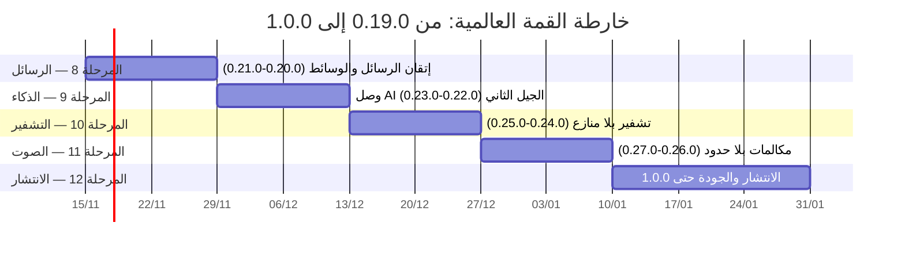

# خارطة القمة العالمية — من 0.19.0 إلى 1.0.0 (المراحل 8–12)

آخر تحديث: 2026-11-14 · الانطلاق 0.19.0+50 · **المنجز حتى 0.24.0+55 (المرحلة 10 أ)** · النطاق: 11 إصداراً (0.20.0+51 → 1.0.0+61)

هذه الخارطة مرسومة فوق الجرد الفعلي للشجرة عند 0.19.0+50: **37 ملف خدمة، 28 شاشة، 29 ترحيل SQL، 14 ملف اختبار نقي**، وقناة بناء ونشر آلية مثبتة على المستودع العام (`waslchat` فرع `app` يبني APK موقّعاً وينشره في Releases تلقائياً عند كل دفع). كل صف في جداول الجرد أدناه مصدره الكود والوثائق المنجزة فعلاً (`docs/ROADMAP.md` و`docs/TRANSPARENCY.md` و`docs/E2EE_PLAN.md`) — لا تخمين.

## المنهج والغرض
1. لكل ميزة موجودة: **حالتها الحقيقية اليوم**، ثم **فجوتها أمام الأقوى عالمياً** (واتساب/تيليجرام/سيجنال/ديسكورد كمرجعيات عامة)، ثم **بند الإكمال** ومرحلته وإصداره المستهدف.
2. كل مرحلة تُنفَّذ بالنمط الثابت: تنفيذ → `flutter analyze` نظيف → `flutter test` ناجح → ترحيل مرقّم عند الحاجة → دفع → بناء ونشر آلي → تحديث `TRANSPARENCY.md` و`ROADMAP.md` → تقرير.
3. كل ميزة جديدة تولد مع اختبارها النقي وإفصاحها الصادق (ما يبقى على الجهاز وما يمر عبر الخادم ولماذا).
4. ميزانية صفر حتى الإطلاق: لا بند في هذه الخارطة يتطلب دفعاً إلا البنود المحسوبة صراحة لبيد المالك.

## المبادئ الثابتة (ورثت من خارطة الطريق)
1. الخصوصية قبل الميزة: أي ميزة تكشف المحتوى للخادم تُوضَّح للمستخدم أو لا تُنفَّذ.
2. لا وعود غير صادقة: لا نقول «مشفّر تماماً» عن شيء غير مشفّر.
3. الفشل يهبط للسلوك السابق، والحدود الصادقة تُكتب داخل الواجهة لا في الوثائق فقط.
4. كل إصدار: تحليل نظيف، اختبارات ناجحة، APK موقّع بنفس المفتاح (alias `wasl`)، ونشر عبر القناة الآلية.

---

## 1) جرد التشفير والخصوصية — أين نقف وأين نقفز
| الميزة | حالتها الآن (مثبتة في الشجرة) | الفجوة أمام الأقوى عالمياً | مكان الإكمال |
|---|---|---|---|
| بدء الجلسات والسرية الأمامية | X3DH ثلاثي + Double Ratchet + **هجين ML-KEM-768 للجلسات الجديدة** (v3، ترحيل 033 — 0.24.0) بمسار info مستقل يهبط كلاسيكياً للطرف القديم | سيجنال PQXDH هي المرجع — نحن الآن على النمط نفسه؛ يتبقى توقيع المفاتيح الأولية (Ed25519) في §9 | مكتملة لمحدودها الحالي — التوقيع لاحقاً |
| تعدد الأجهزة | هوية X25519 ومخزون أولي + كمومي لكل جهاز، تغليف لكل جهاز وأجهزة المرسل نفسه، وإزالة جهاز **كاملة** (ترحيل 021+033 — 0.9.0/0.24.0): حذف المخزون فوراً + بث لحظي يُسقط الجلسات الميتة محلياً + مطابقة دورية | مكتملة لمحدودها: الجهاز المُزال قد يقرأ ما وُجّه إليه قبل الإزالة (سرية أمامية تمنع الجديد) | — |
| تشفير الوسائط | **وسائط الخاص على الجلسة المتدرجة** (0.24.0): مفتاح عشوائي لكل وسيط يُغلَّف داخل الميتا المتدرجة ويُخزن برسالة، والقديمة على v1 رجوعاً — والمجموعات على مفتاحها المغلَّف | المجموعات تدخل سرية أمامية كاملة مع MLS | ما بعد 1.0 مع MLS |
| التحقق من الهوية | رمز أمان 60 رقماً + بطاقة QR لكل طرف + توثيق محلي يتلغى عند تغيّر المفتاح (0.7.5) | لا سجل شفافية للمفاتيح يستطيع المستخدم كشف التلاعب التاريخي به | المرحلة 10 ب (0.25.0) — ترحيل 034 (الرقم 030 قفزته 031/032 صُحح الترقيم) |
| تشفير المحتوى الحساس | التفاعلات وأسماء المجموعات وصورها مشفرة (ترحيل 022 — 0.10.0) | مكتملة لمحدودها الحالي | — |
| النسخ الاحتياطي | نسخة احتياطية للمفاتيح بكلمة سر لا تُستعاد عنك أحد (ترحيل 008) + نسخة قاعدة بيانات ليلية لصاحبها | لا تصدير محادثات مشفر كامل (سيجنال ترفضه عمداً) — قرار تصميم لا يُفتح قبل 1.0 | ما بعد 1.0 (قرار) |

## 2) جرد الرسائل والوسائط
| الميزة | حالتها الآن | الفجوة أمام الأقوى | مكان الإكمال |
|---|---|---|---|
| إرسال الرسائل | نص، صور، صوت، فيديو، ملفات حتى 24 م.ب، ضغط فيديو وتنزيل تلقائي حسب الشبكة (0.4.8) | تيليجرام تسمح بملفات حتى 2 ج.ب؛ رفع الحد مربوط بخطة التخزين | المرحلة 12 (0.28.0) + بند مالك (Supabase Pro) |
| بنية الرسالة | رد، تعديل خلال 48 ساعة، حذف، تفاعلات، نجوم، تثبيت، توجيه، منشن، رسائل مختفية، view-once بفرض من الخادم (0.7.2)، مجدولة ومسودات (0.4.3) | لا ألبومات متعددة الوسائط برسالة واحدة، ولا تحرير صور قبل الإرسال | المرحلة 8 (0.20.0) |
| المعاينات | لا معاينة روابط | كل المنصات الكبيرة تعرض معاينة روابط (وتكشف الرابط لخادمها — نحن سنفصح بدل أن نخفي) | المرحلة 8 (0.21.0) |
| الإشعارات | إشعارات قنوات عربية، رد على رسالة بعينها من الإشعار، تجميع من الخادم (0.4.5/0.7.3) | لا رد سريع ولا تمييز مقروء ولا تفاعل من شريط الإشعار نفسه، لا ويدجت شاشة رئيسية | المرحلة 8 (0.20.0/0.21.0) |
| البحث | بحث ذكي محلي (تطبيع + تسامح أخطاء + مرادفات) داخل المحادثة (0.16.0) + بحث بتهدئة في القائمة | لا بحث موحد عبر كل المحادثات بالمحرك الذكي، ولا بحث دلالي بالمعنى | المرحلة 8 (0.21.0) ثم المرحلة 9 (0.22.0) |
| إدارة المحادثة | أرشفة، كتم، تثبيت، خلفيات، أحجام خط | لا تصدير محادثة نصاً، لا مسح كامل للمحادثة، لا قراءة صوتية للرسائل | المرحلة 8 (0.20.0/0.21.0) |
| الوسائط المجمعة | سلة وسائط وتنظيف تلقائي منتهي الصلاحية (ترحيل 013) | لا معرض وسائط لكل محادثة (شبكة صور/ملفات/روابط) | المرحلة 8 (0.21.0) |

## 3) جرد الصوت والمكالمات
| الميزة | حالتها الآن | الفجوة أمام الأقوى | مكان الإكمال |
|---|---|---|---|
| مكالمة فردية | صوت وفيديو WebRTC P2P مشفّر DTLS-SRTP لا يعبران خادماً (0.17.0، ترحيل 028)، سجل حقيقي يُنظف بعد 90 يوماً | STUN عام فقط — خلف NAT متماثل قد يفشل الاتصال؛ لا رن فوق القفل؛ لا مشاركة شاشة | المرحلة 11 (0.26.0/0.27.0) |
| غرف صوت جماعية | حتى 8 مشاركين mesh بلا خادم ولا تخزين إطلاقاً (0.18.0) | لا مؤشر «يتحدث» بالموجات؛ لا مكالمة جماعية فردية-لأفراد؛ فوق 8 يحتاج SFU/LiveKit | المرحلة 11 (0.26.0/0.27.0) — LiveKit يبقى بقرار ميزانية المالك |
| الصوت في المحادثة | تسجيل وضغط ورسائل صوتية (record/just_audio) | لا قراءة صوتية صادرة (TTS) للرسائل — فرصة عربية فريدة | المرحلة 8 (0.21.0) |
| الحالات | نص وصورة مشفرة 24 ساعة مع مشاهدين (ترحيل 018 — 0.7.0) | فيديو الحالات والرد بحالة متأجلان موثّقان منذ 0.7.0 | المرحلة 11 (0.27.0) |

## 4) جرد المجتمعات والقنوات
| الميزة | حالتها الآن | الفجوة أمام الأقوى | مكان الإكمال |
|---|---|---|---|
| البنية | مجتمعات بقناة إعلانات وغرف، أدوار (مالك/مشرف/عضو)، سلاسل ردود ومنشورات مثبتة (0.5.0/0.5.1) | ديسكورد تتيح أدواراً مخصصة لا نهائية وصلاحيات لكل غرفة بمصفوفة غنية | بحث تصميمي ما بعد 1.0 (ثلاثة أدوار كافية للمجتمعات العربية حتى الإطلاق) |
| الإشراف | كتم مؤقت مرتبب، طرد، فلتر كلمات بتطبيع عربي، سجل ثابت (ترحيل 023 — 0.11.0) + مساعد ذكي اختياري يقترح ولا ينفذ (ترحيل 027 — 0.15.0) | لا توظيف آلي للبوتات في الإشراف الوقائي رغم وجود واجهة بوتات كاملة موقعة | المرحلة 12 (0.29.0) — وثيقة أنماط بوت إشراف |
| الأحداث | إنشاء وتذكير من الخادم (pg_cron كل 10 دقائق) + تقويم هجري حسابي متحقق (0.12.0/0.16.0) | لا عرض تقويم شهري كامل للمجتمع | المرحلة 9 (0.23.0) — لوحة تقويم |
| القنوات | قنوات عامة كبيرة، مشاهدات لكل منشور، إحصاءات 30 يوماً (0.13.0)، شارة توثيق من الإدارة حصراً (ترحيل 026 — 0.14.0) | لا إشعارات تفضيلية لقناة محددة «أعلّم الجرس» | المرحلة 8 (0.21.0) |
| البوتات | واجهة مطوّرين كاملة (getMe/sendMessage/edit/delete/getChat) بحدود وتوقيع HMAC ونصوص مشفرة لا يفكها البوت (ترحيل 025 + bots-api — 0.13.0) | لا لوحة إحصاءات بوت داخل التطبيق | المرحلة 12 (0.29.0) |

## 5) جرد الذكاء (وصل AI)
| الميزة | حالتها الآن | الفجوة أمام الأقوى | مكان الإكمال |
|---|---|---|---|
| المحلي بلا شبكة | تصنيف 12 نية عربية و3 ردود مقترحة، ملخص لآخر 80 رسالة، بحث ذكي (0.16.0) | محرك قواعدي إحصائي — ليس نموذج لغة؛ لا ملخص يومي تلقائي، لا دلالة بالمتجهات | المرحلة 9 (0.22.0) |
| السحابي بموافقة | تلخيص أعمق، ترجمة فورية عربي↔إنجليزي، تفريغ الصوتيات عبر Gemini بلا تخزين لدى وصل (0.16.0، إعادة نشر دالة ai §3.6) | الترجمة محصورة باتجاهين؛ لا لغات إضافية | المرحلة 12 (0.29.0) |
| الصياغة | لا مساعد يصيغ بأسلوب المستخدم | أفضل المساعدات تتعلم نبرة المستخدم | المرحلة 9 (0.23.0) — تعلم محلي من ردودك حصراً |
| التذكير الذكي | لا كشف وعود ومواعيد من الرسائل | ميزة عربية نادرة تخدم ثقافة «اتفقنا الخميس» | المرحلة 9 (0.23.0) |
| نموذج لغة على الجهاز | لا يوجد | الجيل الجديد من التطبيقات يدمج نماذج صغيرة اختيارية | المرحلة 9 (0.23.0) — تقييم بحثي بتنزيل صريح بالحجم |

## 6) جرد المنصات والتوزيع والجودة
| الميزة | حالتها الآن | الفجوة أمام الأقوى | مكان الإكمال |
|---|---|---|---|
| أندرويد | كامل، APK موقّع ينشر آلياً في Releases (قناة `waslchat/app` مثبتة اليوم بإصدار v0.19.0) | مكتملة القناة — تُحفظ كما هي | مستمر |
| الويب | نسخة كاملة على waslchat.app/web تشمل ميزات 0.13.0، لوحة إدارة | لا إشعارات فورية للويب، لا PWA مثبتة | المرحلة 12 (0.28.0) |
| سطح المكتب | خط بناء CI جاهز (ويندوز/لينكس/ماك على وسم v*) بلا أول وسم فعل | لا إصدار منشور، لا إشعارات سطح مكتب | المرحلة 12 (0.28.0) |
| iOS | صفر | توزيع عالمي ناقص | المرحلة 12 (0.29.0 تجهيزاً — النشر بقرار 99$) |
| اللغة | عربي أولاً بإتقان RTL + مركز مساعدة ثنائي | لا إنجليزي كامل للواجهة ولا لغة ثالثة | المرحلة 12 (0.29.0) |
| الاختبارات | 14 ملف اختبار نقي (ratchet، تعدد أجهزة، غرف صوت، ملاحظات، أحداث…) — 37 خدمة | ~خدمات بلا ملف اختبار مخصص | مستعرض المراحل 8–12: كل خدمة جديدة تُولد مع اختبارها، وتغطية القديم تبني إصلاحاً بعد إصلاح |
| القياس | مؤشرات نجاح مكتوبة بلا قياس فعلي (تسليم <ثانية، فتح <ثانيتين، خلل 99.5%) | لا قياس آلي يُعرض في الشفافية | المرحلة 12 (0.29.0) |
| CI الخاص | معطل بسبب نفاد دقائق المستودع الخاص (موثق RUNBOOK §0) — البناء يعمل من القناة العامة | — | بند مالك (يعاد الرصيد 1 ديسمبر أو قرار زيادة الحد) |

---

## المرحلة 8 — إتقان الرسائل والوسائط (0.20.0+51 → 0.21.0+52)
**الهدف: أن تكون رسالة وصل أسرع وأغنى وأسهل من أي منافس — على الجهاز أولاً.**
- [x] الألبوم المتعدد: حتى 10 صور/فيديو برسالة واحدة بمعاينة متسلسلة — عمود `media_group_id` في ترحيل 031، محتوى كل قطعة يُشفَّر كما هو اليوم، والخادم يجمّع بالمعرّف — *(0.20.0)*
- [x] تحرير الصورة قبل الإرسال على الجهاز: قص، تدوير، نص، رسم حر — مكتبة نقية محلية بلا رفع قبل القبول — *(0.20.0)*
- [x] إجراءات الإشعار (أندرويد): رد سريع، تمييز مقروء، تفاعل من شريط الإشعار عبر الإجراءات الممتدة — *(0.20.0)*
- [x] تصدير المحادثة نصاً من الجهاز (نص مفكوك يشاركه صاحبه فقط) ومسح محادثة كامل بتأكيد مزدوج — *(0.20.0)*
- [x] معاينة الروابط: دالة خادمية best-effort تجلب العنوان والصورة المصغرة للروابط العامة، مخزنة 24 ساعة ثم تحذف، مفتاح تعطيل عام، وإفصاح صادق في الإعدادات: «الرابط يمر عبر الخادم عند توليد المعاينة» — *(0.21.0)*
- [x] البحث الموحد: المحرك الذكي نفسه فوق كل المحادثات من شريط القائمة الرئيسية — *(0.21.0)*
- [x] معرض وسائط لكل محادثة: شبكة صور/فيديو/ملفات/روابط بفلترة وفتح بالقفز للرسالة — *(0.21.0)*
- [x] القراءة الصوتية للرسائل (TTS عربي على الجهاز): زر في شريط المحادثة يقرأ الرسالة الأخيرة أو المحددة — *(0.21.0)*
- [x] الويدجت: ويدجت «آخر المحادثات» (3 صفوف) وبديل أيقونة متدرجة — *(0.21.0)*
- [x] «أعلّم الجرس» على القنوات: تفضيل إشعار لكل قناة مستقلة (الكل/المنشورات المثبتة/صمت) — ترحيل 032 بعمود bell ودالة set_channel_bell، والتطبيق في دالة push قبل الإرسال — *(0.21.0)*
- معايير قبول المرحلة: اختبار نقي لخدمة الألبوم والتصدير والمحرك الصوتي؛ إفصاح معاينة الروابط في `TRANSPARENCY.md`؛ القناة العامة تبني وتنشر الإصدارين آلياً.

## المرحلة 9 — وصل AI الجيل الثاني (0.22.0+53 → 0.23.0+54)
**الهدف: أذكى مساعد مراسلة عربي على الجهاز — صفر خادم افتراضياً، وكل اقتراح بلا إرسال أي حرف.**
- [x] البحث الدلالي المحلي: تمثيل متجهي خفيف (كيس كلمات معاير بوزن لوغاريتمي وتطبيع L2 وحذف «ال» التعريف + تشابه cos) فوق الرسائل المفكوكة محلياً يظهر «المحادثات ذات الصلة» من سطر بحث — **منجز في 0.22.0**: `SemanticSearchService` بقسم «ذات صلة دلالياً» في البحث الموحد بتوسيع المرادفات وعتبة حماية من العشوائية
- [x] الملخص اليومي التلقائي لكل محادثة: يُبنى عند أول فتح في اليوم ويُخزن محلياً (مخزن آمن) بلا أي شبكة — **منجز في 0.22.0**: `DailySummaryService/Store` — لا يُخزن ملخص ناقص قبل اكتمال الفك، وملخص الأمس لا يُعرض، والوصول من ✨ «ملخص اليوم»
- [x] ترتيب المحادثات ذكياً محلياً: أولوية من التفاعل (عدّاد فتح محلي بنمو لوغاريتمي) والحداثة (نطاقات معايرة) والإشارات @ ورسائل غير المقروء بسقف، بمفتاح تعطيل في الإعدادات — **منجز في 0.22.0**: `SmartOrderService` والمثبّت أولاً دائماً وثبات التعادل
- [x] مساعد الصياغة بأسلوبك: تعلم محلي من آخر 200 رد أرسلتها (قوالب ونبرة ومستوى رسمية) يقترح 3 صيغ (رسمي/ودي/موجز) — يُبنى ويُخزن ويُحسب كله على الجهاز — **منجز في 0.23.0**: `StyleAssistService` بشريحة دائمة فوق المحرر وإفصاح حرفي، وأقل من 5 ردود لا تتعلم
- [x] التذكيرات الذكية من الرسائل: كشف الوعود والمواعيد في الوارد («اتفقنا الخميس 8») يقترح تذكيراً بنقرة — **منجز في 0.23.0**: `PromiseReminderService` بكشف قواعدي موثق بالثقة وإسقاط المستحيل، والتذكير إشعار محلي مجدول على الجهاز (`scheduleLocalReminder`) — صفر خادم
- [x] لوحة تقويم شهري للمجتمع (هجري/ميلادي) فوق خدمة الهجري المتحققة — **منجز في 0.23.0**: `CalendarGridService` + `CommunityCalendarScreen` بنقاط أحداث ويوم محدد محفوظ عند التبديل
- [x] الترجمة المحلية الأساسية عربي↔إنجليزي (محرك قاموسي جمل محلي بلا شبكة) والسحابي يبقى الأعمق بموافقته — **منجز في 0.23.0**: `LocalTranslateService` بعبارات ثم كلمات وإسقاط «ال» وتطبيع مفهرس بنسبة تغطية صادقة مع كل نتيجة
- [x] تقييم بحثي: نموذج لغة صغير اختياري — **التقييم منجز في 0.23.0** (`OnDeviceModelService` + `ON_DEVICE_LLM.md`: قراءة ذاكرة محلية بلا إذن، كَتالوج بثلاثة مرشحين، معايير قرار مكتوبة، حكم الجهاز، 9 اختبارات نقية) — **والربط الفعلي لمحرك الاستدلال مؤجل بوعي** بقياس ميداني على جهاز متوسط وفق سيناريو القياس الموثق، بلا تنزيل ولا فرض على أحد في هذا الإصدار، وتكلفة التأجيل صفر لأن باقي ميزات المرحلة تعمل كاملة بلا نموذج لغة
- معايير قبول المرحلة: اختبارات نقية لكل محرك جديد؛ توثيق §8 في `E2EE_PLAN.md` يتوسع بكل ميزة؛ قياس زمن الاستجابة موثق في تقرير الشفافية.

## المرحلة 10 — تشفير بلا منازع (0.24.0+55 → 0.25.0+56)
**الهدف: إغلاق كل ملاحظة أمنية مفتوحة والسبق على المعيار العالمي — أن تكون أقوى من سيجنال عربياً.**
- [x] ترقية الوسائط إلى جلسات ratchet الجارية (إغلاق ملاحظة 0.8.0 المفتوحة): الوسائط الجديدة تُغلَّف بمفتاح الجلسة المتدرجة، والقديمة تُقرأ بمسار v1 رجوعاً — **منجز في 0.24.0**: مفتاح عشوائي لكل وسيط يُغلَّف داخل الميتا المتدرجة ويُخزن برسالة عند الوصول، وفك بترتيب صارم (mk المخزن ← الميتا ← v1)
- [x] إزالة جهاز كاملة: حذف مخزون مفاتيحه الأولية من الخادم فوراً + بث إشعار لبقية الأجهزة (الحساب والأطراف) + إسقاط جلساتها — **منجز في 0.24.0**: بث لحظي بحدث حذف devices + مطابقة دورية + نظافة إعادة التسجيل
- [x] بدء جلسات ما بعد الكم: تقييم حزمة ML-KEM نقية مجانية ودمجها مع X3DH (هجين كلاسيكي+كمومي) — **منجز في 0.24.0**: pqcrypto 0.4.4 نقية Dart صفر اعتماديات بمتجهات NIST — ML-KEM-768 لكل مفتاح أولي للجهاز (ترحيل 033) وحقل q بالترويسة وHKDF بمسار info مستقل — لا تأجيل لأن الحزمة بلا كود C
- [ ] شفافية المفاتيح (ترحيل 030): سجل إلحاقي لكل تغيير مفتاح جهاز ببصمة سلسلة، وشاشة «سجل مفاتيحي» تعرض التاريخ الكامل وتتحقق من سلامة السلسلة محلياً — *(0.25.0)*
- [ ] تقرير تصميم MLS للمجموعات الكبيرة (وثيقة أولى بلا تنفيذ، تُفعّل عند تجاوز 8 في الجماعي فعلياً) — *(0.25.0)*
- [ ] المراجعة الأمنية المفتوحة الثانية: `SECURITY.md` v2 تشمل وسائط ratchet والشفافية وما بعد الكم مع نتائج مرقمة جديدة — *(0.25.0)*
- معايير قبول المرحلة: توسيع `ratchet_test` و`multi_device_test` بسناريو الترقية والإزالة؛ عدم كسر توافق v1/v2/v3 بأي حال.

## المرحلة 11 — الصوت والمكالمات بلا حدود (0.26.0+57 → 0.27.0+58)
**الهدف: مكالمات تضاهي أقوى المنصات داخل حدود «بلا ميزانية» ثم ترتقي لحظة قرار المالك.**
- [ ] تكييف جودة الوسائط في المكالمة ومؤشر شبكة ضعيفة (شارة صادقة على جودة الاتصال) — *(0.26.0)*
- [ ] رن المكالمة فوق القفل: ConnectionService على أندرويد بحوار ملء الشاشة والصوت الحلقي — *(0.26.0)*
- [ ] مؤشر «يتحدث» بموجات صوتية حية في غرف الصوت (من مستوى الصوت المحلي لا من الخادم) — *(0.26.0)*
- [ ] مشاركة الشاشة في المكالمة الفردية (بث فيديو صادر من على الجهاز، تشفير DTLS-SRTP نفسه) — *(0.27.0)*
- [ ] المكالمة الجماعية الصوتية حتى 8 بإعادة استخدام محرك غرف الصوت mesh نفسه دون أي خادم — *(0.27.0)*
- [ ] فيديو الحالات والرد بحالة (المتأجلان من 0.7.0): تشفير بنمط الحالات القائم — *(0.27.0)*
- [ ] بنود المالك في هذه المرحلة: نشر coturn (TURN) ذاتي الاستضافة بتعليمات RUNBOOK §8 المحدثة يرفع نجاح الاتصال خلف NAT المتماثل؛ وLiveKit عند النمو فوق 8 — يبقى مؤجلاً بوعي حتى القرار.
- مرفوض تصميمياً ولا يُنفذ أبداً: تسجيل المكالمات — يُكتب في مركز المساعدة كالتزام «ما لا يفعله وصل».
- معايير قبول المرحلة: توسيع `voice_room_test` واختبار حالة المشاركة؛ بقاء «صفر تخزين» في الإشارات والحضور.

## المرحلة 12 — الانتشار والجودة العالمية (0.28.0+59 → 1.0.0+61)
**الهدف: من جهازين اختبارين إلى مستخدمين حقيقيين على كل منصة — ثم إصدار الاستقرار 1.0.0.**
- [ ] رفع حد الملفات مع ترقية التخزين (Supabase Pro بقرار مالك) وتوثيق الحدود الجديدة في كل مكان يذكر 24 م.ب — *(0.28.0)*
- [ ] إشعارات الويب الفورية + PWA قابلة للتثبيت (تقارير Service Worker) — *(0.28.0)*
- [ ] أول إصدار سطح مكتب رسمي: وسم v0.28.0 يشغل خط بناء desktop الموجود، وينشر ثلاث حزم مع APK في Releases، مع إشعارات سطح مكتب أساسية — *(0.28.0)*
- [ ] iOS: تجهيز كامل للبناء (تفويضات، بناء ويب iOS محلي، شاشات) — رفع المتجر بقرار 99$ مالك — *(0.29.0)*
- [ ] تعدد اللغات: إنجليزي كامل للواجهة + فرنسي أساسي، مع بقاء العربية اللغة الأم للتصميم — *(0.29.0)*
- [ ] القياس الآلي لمؤشرات النجاح: زمن فتح بارد، زمن تسليم رسالة، معدل أعطال Crashlytics — تُعرض أرقامها في تقرير الشفافية لكل إصدار — *(0.29.0)*
- [ ] وثيقة أنماط بوت إشراف آلي للمجتمعات فوق `BOTS_API.md` + لوحة إحصاءات بوت داخل التطبيق — *(0.29.0)*
- [ ] **1.0.0+61**: قائمة اختبار ميداني كاملة (بنود RUNBOOK المحدثة) على جهازين حقيقيين، تقرير شفافية 1.0، المراجعة الأمنية الثالثة، ووسم رسمي يبني كل المنصات دفعة واحدة — إصدار الاستقرار الذي يُعلن للعالم.
- معايير قبول المرحلة: كل منصة جديدة تنشر من القناة الآلية نفسها؛ لا إصدار قبل تحليل نظيف واختبارات ناجحة على المنصات الثلاث.

---

## المخطط الزمني المرئي

## ما لن نفعله أبداً (التزامات تصميمية مكتوبة)
1. تسجيل المكالمات — مرفوض بلا نقاش.
2. رفع أي محتوى مشفر لطرف ثالث أو لواجهة ذكاء بلا موافقة صريحة لكل استخدام.
3. إعلانات داخل المحادثات، أو بيع/مشاركة بيانات — لا نموذج ربح عليه البحث أصلاً.
4. ميزة «شبه مشفرة»: أي مسار صريح يُكتب في الواجهة والشفافية كصراحة، لا يُلبس برسالة تشفير.

## بنود المالك المجمعة (قرارات لا تنفذها الأدوات)
| البند | التكلفة | يفتح ماذا |
|---|---|---|
| فتح Google Play Console | 25$ مرة واحدة | رفع APK/AAB والحزمة الجاهزة (0.19.0) — أكبر خطوة انتشار |
| تشغيل الترحيلات المتبقية على الخادم | مجاني | 015/028/029 في SQL Editor — يفعّل الإبلاغ وسجل المكالمات والملاحظات |
| Supabase Pro | 25$/شهر عند النمو | رفع حد الملفات (المرحلة 12) والمساحة |
| TURN ذاتي الاستضافة | تكلفة خادم بسيطة | نجاح مكالمات خلف NAT المتماثل (المرحلة 11) |
| Apple Developer | 99$/سنة | نشر iOS (المرحلة 12) |
| زيادة حد دقائق Actions أو انتظار 1 ديسمبر | حسب القرار | عودة CI الخاص — القناة العامة تؤدي الدور اليوم كاملاً |
| الاختبار الميداني على جهازين | وقت فقط | بوابة إصدار 1.0.0 |

## مؤشرات النجاح المحدثة
- تسليم الرسالة أقل من ثانية وفتح التطبيق أقل من ثانيتين — **مقاسة آلياً وتُعرض في الشفافية ابتداء من 0.29.0**.
- خلل أقل من 0.5% من الجلسات (Crashlytics).
- 100% من المحادثات الخاصة والمجموعات الخاصة مشفرة تماماً — **والوسائط تنضم لمسار ratchet في 0.24.0**.
- كل إصدار في المراحل 8–12 ينشر آلياً في Releases العامة خلال دقائق من الدفع.
- تقييم 4.6+ في Play بعد الإطلاق.

## مراجع
- `docs/ROADMAP.md`: خارطة الطريق الكاملة والمراحل المنجزة 0–7.
- `docs/E2EE_PLAN.md`: تصميم التشفير وما يخرج بموافقة (§8).
- `docs/TRANSPARENCY.md`: تقرير الشفافية — يُحدَّث مع كل إصدار في هذه الخارطة.
- `docs/RUNBOOK_URGENT.md`: بنود المالك وإجراء المزامنة مع القناة العامة وقائمة الاختبار الميداني.
- `docs/BOTS_API.md`: واجهة البوتات (أساس أنماط الإشراف الآلي في 0.29.0).
