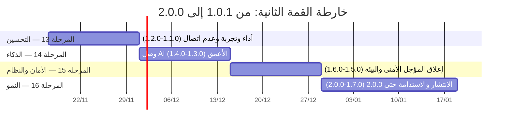

# خارطة القمة الثانية — من 1.0.1 إلى 2.0.0 (المراحل 13–16): التطوير والإكمال والتحسين الشامل

آخر تحديث: 2026-11-16 · نقطة الانطلاق: **1.0.1+62** · الهدف: **2.0.0+71**

## المنهج والغرض

اكتملت خارطة القمة الأولى (`docs/GRAND_PLAN.md`، المراحل 8–12) بإصدار الاستقرار 1.0.0 وترقعة 1.0.1 — وبذلك أُغلق كل بند برمجي فيها. هذه الوثيقة تفتح **القمة الثانية**: ما بعد الاستقرار، بثلاثة مسارات واضحة في كل مرحلة:

- **تطوير**: ميزات جديدة ترفع السقف أمام الأقوى عالمياً.
- **إكمال**: بنود مؤجلة بوعي منذ إصدارات سابقة (موثقة في E2EE_PLAN §9 وMLS_DESIGN وON_DEVICE_LLM) تُغلق في موعدها.
- **تحسين**: كل ما هو قائم يصير أسرع وأخف وأسهل — بأرقام مقاسة تُعرض في الشفافية لا بأدعاء.

القواعد الثابتة وراثةً من القمة الأولى: الصدق قبل الميزة، الخصوصية قبل كل شيء، ميزانية صفر حتى قرار المالك، وكل إصدار تحليل نظيف واختبارات ناجحة وحزمة موقعة من القناة العامة نفسها.

## أين نقف الآن — جرد 1.0.1+62 وفجوات ما بعد الاستقرار

| المجال | الواقع المثبت في الشجرة | الفجوة المتبقية | مكان الإغلاق |
|---|---|---|---|
| التشفير | X3DH ثلاثي + Double Ratchet + هجين ML-KEM-768 (033) + وسائط على الجلسة المتدرجة + إزالة جهاز كاملة + شفافية مفاتيح بسلسلة متحققة محلياً (034) | توقيع المفاتيح الأولية Ed25519 (§9 مؤجل)، الشهود الخارجيون لشفافية المفاتيح (حد F7)، MLS للجمعات الضخمة (تصميم جاهز بلا تنفيذ) | المرحلة 15 |
| الرسائل والوسائط | ألبومات وتحرير صور وإجراءات إشعار وتصدير ومسح (031) ومعاينة روابط وبحث موحد ومعرض وTTS وويدجت وجرس قنوات (032) | **لا طابور إرسال بلا شبكة** — رسالة تُرسل وفشلت الشبكة تعتمد على سلوك الخصائص القائم، وحد الملفات 24 م.ب بند مالك (كود MediaLimits جاهز) | المرحلتان 13 و16 |
| الصوت والمكالمات | فردية صوت ومرئي P2P مشفرة (028) + رن فوق القفل + شارة جودة متكيفة + موجات «يتحدث» + مشاركة شاشة + جماعية حتى 8 على المحرك نفسه + فيديو حالات (035) | TURN خلف NAT المتماثل (بند مالك — تعليمات §8 جاهزة)، وفوق 8 يحتاج SFU/LiveKit بقرار مالك | المرحلة 15 |
| الذكاء (وصل AI) | محركات على الجهاز حصراً: نوايا وملخص وبحث ذكي ودلالي متجهي وترتيب ذكي وصياغة بأسلوبك وكشف وعود وتذكير محلي وتقويم هجري مجتمعي وترجمة قاموسية + سحابية بموافقة | النموذج اللغوي على الجهاز: تقييم بحثي منجز (0.23.0) والربط الفعلي مؤجل بوعي حتى قياس ميداني — موثق في `ON_DEVICE_LLM.md` | المرحلة 14 |
| المنصات | أندرويد كامل بAPK موقّع آلي + ويندوز/لينكس/ماك بحزم منشورة (0.28.0) + iOS بناء أرشيف جاهز (0.29.0) + ويب PWA وإشعارات متصفح Web Push متحققة بدوري (036) | Google Play غير مفتوح (بند مالك 25$ — الحزمة والمواد جاهزة في `PLAY_SUBMISSION.md`)، iOS غير منشور (بند مالك 99$ — إجراءات §9 جاهزة) | المرحلة 16 |
| الجودة | 540/540 اختباراً نقياً في 46 ملفاً وتحليل نظيف 100% ومراجعتان أمنيتان مفتوحتان بعلامات F1–F18 وقائمة اختبار ميداني مرقمة | خدمات قديمة بلا ملف اختبار مخصص، وحجم الحزمة 73 م.ب بلا هدف موثق، ولا طابور عدم اتصال | المرحلة 13 |

---

## المرحلة 13 — التحسين الشامل: أداء وتجربة وعدم اتصال (1.1.0+63 → 1.2.0+64)

**الهدف: أن يصير وصل أسرع وأخف وأسهل تطبيق عربي — بأرقام قبل/بعد تُعرض في تقرير الشفافية لا بادعاءات.**

- [ ] **طابور إرسال بلا شبكة (offline-first للرسائل)** — *(1.1.0)*: كل رسالة نصية أو وسيط يفشل إرساله لغياب الشبكة يُحفظ محلياً بحالة «بانتظار الشبكة» صادقة تُعرض على الرسالة نفسها، ويُعاد الإرسال تلقائياً بالترتيب عند عودة الاتصال، فوق المخزن الآمن القائم وبلا ترحيل خادمي إطلاقاً — التحقق النقي: الطابور ينجو من قتل التطبيق ولا يكرر رسالة ولا يفسد ترتيبها، ومفتاح تعطيل غير مطلوب لأن السلوك هو المتوقع دائماً.
- [ ] **قائمة الرسائل الافتراضية الكاملة** — *(1.1.0)*: محادثة بعشرات الآلاف من الرسائل تتمرر بسلاسة ببناء العناصر المرئية حصراً، مع قفز موثق إلى رسالة البحث والرد والنجمة — وقياس السقوط الإطاري (jank) يُضاف لورقة الأرقام في الإعدادات.
- [ ] **ذاكرة وسائط ذكية بسقف معلن** — *(1.1.0)*: تخزين مؤقت LRU بسقف يعرضه المستخدم ويعدّله من الإعدادات (الافتراضي موثق)، الأحدث استعمالاً يبقى والأقدم يُنظف ذاتياً، والمسح لا يمس الأصل على الخادم أبداً.
- [ ] **تقليل البطارية والشبكة** — *(1.2.0)*: دمج اشتراكات Realtime المتعددة بقناة واحدة منظمة وتقليم المستمعين المتسربين (فحص attach/detach على كل شاشة) — وقياس استهلاك موثق قبل/بعد على جهاز متوسط في ملاحظات الإصدار.
- [ ] **RTL وإمكانية الوصول النهائية** — *(1.2.0)*: مراجعة شاشة بشاشة على أجهزة حقيقية (الاتجاه والقص والحفافات)، وقارئ الشاشة TalkBack على الشاشات العشر الأساسية بتسميات عربية صادقة، وتباين WCAG AA للوضعين الفاتح والداكن — والحدود المعلنة تعرض في مركز المساعدة لا تُخفى.
- [ ] **نضج الاختبارات وحجم الحزمة** — *(1.2.0)*: رفع الاختبارات من 540 إلى 600+ بتغطية كل خدمة بلا ملف اختبار، وتقليم اعتماديات بلا استعمال مع إثبات البناء بعدها، وهدف حجم موثق للحزمة يُقاس ويعرض في ملاحظات كل إصدار لاحق.
- معايير قبول المرحلة: أرقام قبل/بعد لكل بند تُكتب في `TRANSPARENCY.md` وملاحظات الإصدار؛ لا ترحيل خادمي إلا إن اقتضاه بند فعلاً؛ تحليل نظيف واختبارات ناجحة والحزمة موقعة من القناة العامة.

## المرحلة 14 — وصل AI الأعمق: من المحركات إلى النموذج (1.3.0+65 → 1.4.0+66)

**الهدف: أن يفهم وصل معنى رسائلك وأرشيفك على جهازك حصراً — والنموذج اللغوي خيار بتنزيل صريح لا فرض ولا ادعاء.**

- [ ] **اسأل وصل: أرشيفك يجيبك محلياً (RAG فوق الدلالة القائمة)** — *(1.3.0)*: واجهة «اسأل وصل» تجيب سؤالك من رسائلك المفكوكة على جهازك فقط: البحث الدلالي المتجهي القائم (0.22.0) يجيب المقاطع ذات الصلة ومحرك الاستخلاص يبني الإجابة منها، وكل إجابة تعلن مصدرها (المحادثة والتاريخ) — **صفر حرف يغادر الجهاز**، والسحابي الأعمق يبقى بديلاً اختيارياً بموافقة صريحة لكل استخدام.
- [ ] **الملخص الأسبوعي للمحادثات والمجتمع** — *(1.3.0)*: بنمط الملخص اليومي المُختبَر نفسه بنافذة أسبوع متدحرجة — لكل محادثة ولوحة مجتمع، تخزين محلي آمن وبلا شبكة.
- [ ] **ترجمة محلية موسعة وكشف لغة** — *(1.3.0)*: كتالوج العبارات القاموسي يتوسع (التحيات والمواعيد والأرقام والتعبيرات المتكررة في المراسلة العربية) وكشف اللغة التلقائي للنص المعروض، والسحابية تتوسع لغات أكثر (فرنسي/تركي/أوردو حسب طلب المستخدمين العربي) بموافقته القائمة.
- [ ] **بحث وسائط صادق** — *(1.4.0)*: بحث داخل معرض كل محادثة بالنوع والحجم والتاريخ والمحادثة المصدر فوق معرض 0.21.0 — بلا ادعاء رؤية محتوى الصورة: نبحث في ميتاداتا نملكها محلياً ونعلن ذلك.
- [ ] **تذكيرات المناسبات الهجرية العربية** — *(1.4.0)*: فوق HijriService المتحققة والتقويم المجتمعي (0.23.0): تذكير محلي بالمناسبات (رمضان والعيدين والرأس الهجري) وقربها، بمفتاح تعطيل وإشعارات محلية حصراً — ميزة عربية لا يقدمها أي منافس عالمي.
- [ ] **النموذج اللغوي على الجهاز: تنفيذ المسار البحثي الموثق** — *(1.4.0)*: عند توفر جهاز قياس متوسط يُنفذ سيناريو `ON_DEVICE_LLM.md` القائم: تنزيل صريح بالحجم قبل أي تشغيل، وحكم الجهاز معلن بمعاييره المكتوبة، ومفتاح تعطيل فوري، والفشل يهبط للمحركات القواعدية بصدق — **إن لم يتوفر جهاز القياس يبقى المسار مؤجلاً موثقاً ولا ادعاء**، وتكلفة التأجيل صفر لأن باقي بنود المرحلة تعمل كاملة بلا نموذج.
- معايير قبول المرحلة: كل محرك جديد يُوثق ب§8 في `E2EE_PLAN.md` (لا تدفق جديد على السلك إلا بحدود صريحة)؛ اختبارات نقية لكل محرك؛ إفصاح TRANSPARENCY لكل بند قبل الإصدار.

## المرحلة 15 — الأمان والنظام البيئي (1.5.0+67 → 1.6.0+68)

**الهدف: إغلاق كل بند أمني مؤجل بوعي، وتوسيع النظام البيئي للمطورين والمجتمعات الكبيرة — والمراجعة الأمنية الرابعة تحرس كل خطوة.**

- [ ] **Ed25519 لتوقيع المفاتيح الأولية** — *(1.5.0)*: تنفيذ §9 المؤجل في `E2EE_PLAN.md`: مفتاح توقيع للهوية يوقّع كل مفتاح أولي يُنشر، ويظهر التحقق في شاشة رمز الأمان وفي شفافية المفاتيح (ترحيل 037 بعمود توقيع ودالة إلحاح مطورة)، والطرف القديم بلا توقيع يبقى يعمل والتوقيع يتحقق عند التوثيق اليدوي — توافق رجعي كامل بنمط ترحيل 033.
- [ ] **شهود خارجيون لشفافية المفاتيح (إغلاق حد F7)** — *(1.5.0)*: مراقب مفتوح المصدر صغير يقرأ السجل الإلحاحي العام بperiodic وينشر بصمة رأس السلسلة في مستودع مستقل، ووثيقة تشرح لأي طرف ثالث كيف يتحقق بنفسه — الحد البنيوي المعلن منذ 0.25.0 يُغلق بأداة عامة لا بوعد.
- [ ] **MLS للجمعات الضخمة عند تجاوز السعة فعلياً** — *(1.6.0)*: تنفيذ خطة `MLS_DESIGN.md` وثيقةً بثوثقةً كاملة: اختيار المكتبة بمعاييرها الأربعة المكتوبة (نقية/صفر اعتماديات/متجهات interop/نضج) أو بناء النواة داخلياً، وepochs وCommit عبر البنية القائمة بلا خادم جديد، وانتقال بتوافق كامل — **لا يبدأ قبل ظهور مجموعات حقيقية فوق حدود النمط المغلف المعلنة** (التسليم المغلف موثق بحدوده) فلا تعقيد بلا حاجة مثبتة.
- [ ] **واجهة مطوّرين موسعة** — *(1.6.0)*: فوق `BOTS_API.md` الموقعة: أحداث webhooks بتوقيع HMAC للبوتات الموثوقة، ووثيقة دعوات وبرمجية وسيطة بحدود صادقة — بلا صلاحية جديدة تتجاوز نموذج البوت القائم بلا موافقة.
- [ ] **الإشراف الآلي الفاعل وسوق بوتات مبسط** — *(1.6.0)*: أنماط `BOT_MODERATION_PATTERNS.md` تنقل من «ينبه» إلى «ينفذ بعد موافقة المشرف لحظة بلحظة» (زر موافقة في بطاقة التنبيه)، ودليل نشر بوت مجتمعي خطوة بخطوة، ولوحة إحصاءات البوت تعرض ما يمكن قراءته فعلاً بنفس الصدق.
- [ ] **TURN ذاتي الاستضافة عند قرار المالك** — *(بند مالك — الكود جاهز)*: تعليمات RUNBOOK §8 المحدثة تنشر coturn ويُضاف للإعدادات، فيرتفع نجاح الاتصال خلف NAT المتماثل — والكود يستقبله من الإعدادات دون ترحيل.
- معايير قبول المرحلة: **المراجعة الأمنية المفتوحة الرابعة** بنتائج مرقمة جديدة في `SECURITY.md` تغطي التوقيع والشهود وأي تنفيذ MLS؛ لا ترحيل بلا تحقق pglast وفحص RLS صلاحيةً صلاحية؛ توافق المسارات السلكية الأربعة يُختبر بعد كل بند.

## المرحلة 16 — النمو والاستدامة حتى 2.0.0 (1.7.0+69 → 2.0.0+71)

**الهدف: من الاستقرار إلى الانتشار الحقيقي — مستخدمون فعليون، ونموذج استدامة صادق بلا إعلانات ولا بيع بيانات.**

- [ ] **إطلاق Google Play الرسمي** — *(1.7.0 — بند مالك 25$)*: الحزمة المرشحة والمواد الكاملة جاهزة في `PLAY_SUBMISSION.md` منذ 0.19.0، وما بعد القبول: شاشة «تحديث متوفر» توجّه للمتجر وتحفظ القناة العامة كخيار مباشر بجواره.
- [ ] **نشر iOS بعد التوقيع** — *(1.7.0 — بند مالك 99$)*: أرشيف Runner.app الذي يبنيه CI منذ 0.29.0 يوقّع ويرفع وفق RUNBOOK §9 خطوة بخطوة.
- [ ] **اختبار ميداني واسع (beta داخل التطبيق)** — *(1.7.0)*: قناة انضمام اختبار بعائِل صادق (ما الذي يختبر وما الذي لا يزال ناقصاً)، وتقرير ملاحظات يبني على نظام الملاحظات القائم بتصنيف، وإصلاح ما يظهر بأولوية — بوابة 2.0.0.
- [ ] **فتح المحركات النقية مفتوح المصدر** — *(1.8.0)*: مستودعات مستقلة للمحركات الخالية من الأسرار (ratchet، البحث الدلالي، الهجري، الترجمة المحلية، تقييم النموذج، موجات الصوت) بعد مراجعة تتحقق خلو كل مستودع من أي سر، برخصة موحدة — شفافية نموذجية تبني ثقة عربية قابلة للتحقق لا للادعاء.
- [ ] **دليل استضافة ذاتية كامل** — *(1.8.0)*: وثيقة تشغيل وصل بخادمك الخاص: Supabase ذاتي الاستضافة وcoturn والترحيلات بالترتيب والنسخ الاحتياطي — سؤال «أين بياناتنا؟» يجيب بالإمكانية نفسها لا بالوعود.
- [ ] **2.0.0+71: إصدار النضج** — *(2.0.0)*: المراجعة الأمنية الخامسة، تقرير شفافية 2.0 بجرد كامل، اختبار ميداني على ثلاثة أجهزة حقيقية، ووسم رسمي يبني المنصات الأربع دفعة واحدة — إعلان التطبيق العربي الذي لا يخون، بعدوى قابلة للتحقق.
- معايير قبول المرحلة: كل منصة جديدة من القناة الآلية نفسها؛ لا إصدار قبل تحليل نظيف واختبارات ناجحة؛ تقرير الشفافية يتحدث مع كل خطوة ويبقى بلا استثناء جديد.

## مسار التحسين المستعرض (في كل إصدار من 13 إلى 16)

- كل خدمة جديدة تولد مع اختبارها النقي وإفصاح `TRANSPARENCY.md` وربط §8 إن لمست السلك.
- لا ترحيل SQL بلا تحقق المحلل الرسمي pglast وفحص RLS صلاحيةً صلاحية.
- حجم الحزمة وزمن البناء يُقاسان ويوثقان في ملاحظات كل إصدار.
- الوثائق الثلاث (README وRUNBOOK وTRANSPARENCY) تتحدث مع كل إصدار قبل الدفع.
- قاعدة الرسائل النظيفة للمرآة: إصدارات القناة العامة بلا «[skip ci]» أبداً، والالتزامات التوثيقية تحملها عمداً.
- الأسرار في `secrets/` بالمستودع الخاص حصراً، وشجرة كل وسم تتحقق برمجياً قبل الدفع (قاعدة F17).

## المخطط الزمني المرئي

## ما لن نفعله أبداً (وراثة من القمة الأولى وتوسيعها)

1. تسجيل المكالمات — مرفوض بلا نقاش.
2. رفع أي محتوى مشفر لطرف ثالث أو لواجهة ذكاء بلا موافقة صريحة لكل استخدام.
3. إعلانات داخل المحادثات، أو بيع/مشاركة بيانات — الاستدامة تُبنى بقرار مالك شفاف لا ببيع المستخدم.
4. ميزة «شبه مشفرة»: أي مسار صريح يُكتب صراحة في الواجهة والشفافية، لا يُلبس برسالة تشفير.
5. **(جديد)** نموذج لغة يُنزَّل ضمنياً: أي نموذج على الجهاز يصلك بتنزيل صريح بالحجم ومفتاح تعطيل — لا تضمين في الحزمة ولا تنزيل خفي.
6. **(جديد)** مستودع مفتوح يحتمل سراً واحداً: المراجعة قبل النشر بند معياري لا خطوة شكلية.

## بنود المالك المجمعة في القمة الثانية (قرارات لا تنفذها الأدوات)

| البند | التكلفة | يفتح ماذا | موعده |
|---|---|---|---|
| فتح Google Play Console | 25$ مرة واحدة | الإطلاق الرسمي أندرويد (المرحلة 16) — المواد جاهزة | 1.7.0 |
| Apple Developer | 99$/سنة | نشر iOS (المرحلة 16) — الإجراءات جاهزة §9 | 1.7.0 |
| Supabase Pro | 25$/شهر عند النمو | رفع حد الملفات فوق 24 م.ب (كود MediaLimits جاهز من 0.28.0) | عند النمو |
| TURN ذاتي الاستضافة | خادم بسيط | نجاح مكالمات خلف NAT المتماثل (المرحلة 15 — تعليمات §8 جاهزة) | 1.6.0 |
| جهاز قياس متوسط للنموذج | جهاز قائم | تفعيل مسار النموذج على الجهاز (المرحلة 14 — السيناريو جاهز) | 1.4.0 |
| تجديد دقائق Actions الخاصة | مجاني عند التجديد | عودة CI الخاص (القناة العامة تؤدي الدور كاملاً اليوم) | متى شاء |

## مؤشرات النجاح للقمة الثانية

- فتح بارد أقل من 1.5 ثانية على جهاز متوسط — مقاساً بMetricsStore ومنشوراً في الشفافية.
- تمرير قائمة بعشرة آلاف رسالة بلا سقط إطارات مقاس — رقم معلن.
- رسالة بلا شبكة تصل تلقائياً عند العودة — مختبرة نقياً وميدانياً.
- 600+ اختبار نقية وتحليل نظيف في كل إصدار من القمة الثانية.
- صفر ترحيل بلا تحقق pglast، وصفر سر خارج `secrets/`، وصفر بند شفافية بلا كود يثبته.
- تقييم 4.6+ في Play بعد الإطلاق، وتقرير شفافية بلا استثناء جديد عند 2.0.0.

## مراجع

- `docs/ROADMAP.md`: خارطة الطريق الكاملة — المراحل المنجزة 0–12 والقمة الثانية.
- `docs/GRAND_PLAN.md`: خارطة القمة الأولى (8–12) — مكتملة بإصدار الاستقرار 1.0.0 وترقعة 1.0.1.
- `docs/E2EE_PLAN.md`: §9 (توقيع Ed25519 المؤجل) وسلسلة §8 «حدود بصراحة» — المرحلة 15 تنفذ §9.
- `docs/MLS_DESIGN.md`: خطة MLS الجاهزة بالكامل — تفعّل في المرحلة 15 عند تجاوز السعة فعلياً.
- `docs/ON_DEVICE_LLM.md`: المسار البحثي للنموذج على الجهاز — ينفذ في المرحلة 14 عند توفر القياس.
- `docs/BOTS_API.md` و`docs/BOT_MODERATION_PATTERNS.md`: أساس النظام البيئي (المرحلة 15).
- `docs/PLAY_SUBMISSION.md` و`RUNBOOK_URGENT.md` §9: حزم الإطلاق والإجراءات الجاهزة (المرحلة 16).
